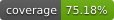

# Network Reputation Check Action


[](https://github.com/pre-commit/pre-commit)




A GitHub Action and CLI tool to check the reputation of IPs, domains, or CIDR blocks using threat intelligence sources like VirusTotal and urlscan.io.

## ✅ Features
- Click-powered CLI
- Supports one source per run
- Works as a Docker-based GitHub Action
- Clean, pluggable design with tests

## 🔧 Usage (CLI)

Local installs require Python 3.11 or newer.

```bash
poetry run reputation-check <target> --source <source> [--api-key YOUR_KEY] [--output-file output.json]
```

### CLI Parameters
- `target` (required): The IP, domain, or CIDR block to check.
- `--source` (required): The source to use for the reputation check (e.g., `virustotal`, `urlscan`).
- `--api-key` (optional): The API key for the selected source. Can also be set via environment variables (`VT_API_KEY` for VirusTotal, `URLSCAN_API_KEY` for urlscan.io).
- `--output-file` (optional): Path to save the raw JSON result.

## 🚀 Usage (GitHub Actions)

```yaml
- name: Run Network Reputation Check
  uses: ig596/network-reputation-check-action@main
  with:
    target: "example.com"
    source: "virustotal"
    api-key: "${{ secrets.VT_API_KEY }}"
```

### GitHub Action Parameters
- `target` (required): The IP, domain, or CIDR block to check.
- `source` (required): The source to use for the reputation check (e.g., `virustotal`, `urlscan`).
- `api-key` (optional): The API key for the selected source. Can be passed via GitHub Secrets.

## 📦 Supported Sources
- VirusTotal
- urlscan.io

## 🔑 API Keys
- VirusTotal: `VT_API_KEY` (required)
- urlscan.io: `URLSCAN_API_KEY` (optional for most API calls)

## 🔧 Development Setup

### Pre-commit Hooks

This project uses pre-commit hooks to enforce code quality. Install and activate them with:

```bash
pip install pre-commit
pre-commit install
```

You can manually run the hooks on all files with:
```bash
pre-commit run --all-files
```

## 📜 License
This project is licensed under the [MIT License](LICENSE).

## Repository scanning and SARIF

Scan a directory with the CLI:

```bash
poetry run reputation-check --source virustotal --api-key "$VT_API_KEY" \
  --scan-path . --output-file results.json --sarif-file results.sarif
```

Use either a target or `--scan-path`. SARIF output requires scan mode. Both
providers require an API key in this implementation. Public IPs (IPv4 and IPv6),
domains and CIDRs are discovered and deduplicated, with source file/line locations.
Private/reserved addresses, local/example domains (including their subdomains),
symlinks, binary files, files larger than 1 MB and common build directories are
excluded. Specified JSON/SARIF outputs are excluded from discovery on subsequent
runs. Discovery uses text patterns and may include dotted identifiers; review the
scan directory before sending discovered values to a third-party provider.

VirusTotal supports individual IPs and domains; urlscan supports domains. Neither
provider here supports CIDR lookups. Unsupported indicator types and lookup errors
are recorded in JSON/SARIF and fail the scan, as do malicious or suspicious
VirusTotal results. CIDRs are not expanded into potentially huge sets of requests.
urlscan search matches alone do not establish that an indicator is malicious.
Scans with no indicators succeed and write empty reports.

A scan refuses more than 100 unique indicators before any requests. Use
`--max-indicators` (or the action's `max-indicators` input) to adjust this cap.
Providers may also enforce rate limits; those lookup errors fail the scan.

```yaml
permissions:
  contents: read
  security-events: write
steps:
  - uses: actions/checkout@v7
  - name: Scan repository
    uses: ig596/network_reputation_checks@main
    with:
      source: virustotal
      api-key: ${{ secrets.VT_API_KEY }}
      scan-path: .
      sarif-file: results.sarif
      output-file: results.json
  - name: Upload findings even when the scan fails
    if: ${{ !cancelled() && hashFiles('results.sarif') != '' }}
    uses: github/codeql-action/upload-sarif@v4
    with:
      sarif_file: results.sarif
```

The action accepts optional `scan-path`, `sarif-file`, `output-file` and
`max-indicators` inputs. Empty optional inputs are omitted from the command.
Single-target runs still work without these inputs. GitHub Code Scanning must be
available for the repository before uploading SARIF. When scanning a subdirectory,
run from the repository root so SARIF locations resolve to checked-out files.
